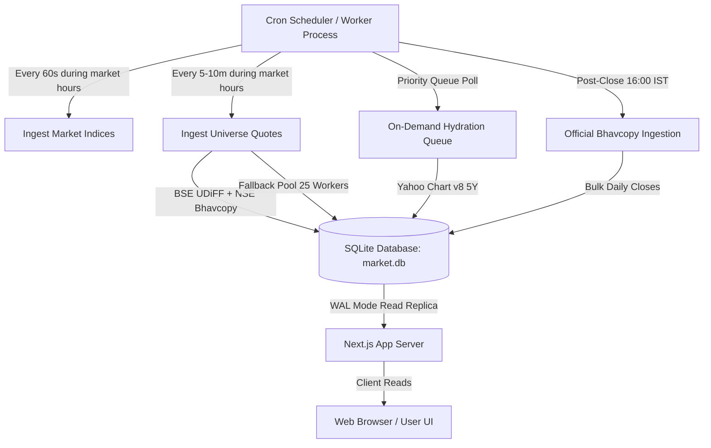

# 24/7 Market Ingestion Worker Runbook

This runbook documents the architecture, scheduling, failover, and operational procedures for the continuous background ingestion worker of the **Bharatiya Bajar** stock market platform.

---

## 1. Architecture Overview

The ingestion system operates independently of the Next.js web application to guarantee zero external HTTP fetch latency at page-load time.



---

## 2. Worker Command Line Interface

- **Continuous 24/7 Loop**:
  ```bash
  pnpm worker
  # or
  node --experimental-strip-types scripts/worker.ts
  ```
- **Single Iteration (for cron jobs or CI/CD)**:
  ```bash
  node --experimental-strip-types scripts/worker.ts --once
  ```
- **Full Universe Ingestion (All Datasets)**:
  ```bash
  pnpm ingest:all
  ```
- **Individual Ingestion Jobs**:
  ```bash
  pnpm ingest:quotes        # Quotes for all 4,943 companies (Bhavcopy + Fallback pool)
  pnpm ingest:history 100   # 5-Year daily OHLCV for top 100 companies
  pnpm ingest:profiles      # Bilingual profiles for 100% of companies
  pnpm classify:sectors     # 100% normalized sector classification
  pnpm ingest:indices       # Nifty 50, Sensex, Bank Nifty, IT
  pnpm ingest:holidays      # Official NSE & BSE trading holidays
  ```

---

## 3. Scheduled Cron Configuration (Linux / Production)

```cron
# 1. Market Hours Live Quote Sweep (Every 5 minutes, Mon-Fri 09:15-15:35 IST)
*/5 9-15 * * 1-5 cd /app && pnpm ingest:quotes >> /var/log/quotes.log 2>&1

# 2. Benchmark Index Quotes (Every minute during market hours)
* 9-15 * * 1-5 cd /app && pnpm ingest:indices >> /var/log/indices.log 2>&1

# 3. Post-Close Official Bhavcopy Sweep (Daily at 16:30 IST)
30 16 * * 1-5 cd /app && pnpm ingest:quotes >> /var/log/bhavcopy.log 2>&1

# 4. Weekly Fundamentals & Shareholding Sweep (Saturday 02:00 IST)
0 2 * * 6 cd /app && pnpm ingest:financials >> /var/log/financials.log 2>&1
```

---

## 4. Concurrency, Chunking & Circuit Breaking

1. **Bhavcopy Bulk Processing**:
   - Downloads official BSE UDiFF CSV (4,700+ scrips) and NSE Bhavdata (3,300+ equities).
   - Ingests in a single SQLite transaction with batch size 5,000 within 25–28 seconds.
2. **Fallback Pool Concurrency**:
   - For illiquid scrips not traded in the daily Bhavcopy, a worker pool runs with concurrency cap `CONCURRENCY = 25`.
   - On HTTP 429 or 403, the pool triggers exponential backoff with 500ms ± 200ms jitter.
3. **Database Performance**:
   - `PRAGMA journal_mode = WAL;`
   - `PRAGMA synchronous = NORMAL;`
   - Dedicated indexes on `price_live(isin, quote_time)`, `price_history(isin, exchange, date)`, `company(sector_slug)`.

---

## 5. Observability & Monitoring

- **Observability Dashboard**: Accessible at `/admin/data-health`.
- **Health Check API**: `GET /api/admin/data-health`.
- **Data Freshness Table**: Inserts into `data_freshness` on every run with `latest_as_of`, `last_successful_run`, `record_count`, and `status`.
- **Job Run Audit Table**: Tracks every job run in `ingestion_run` with start time, completion time, records processed, and error messages.
